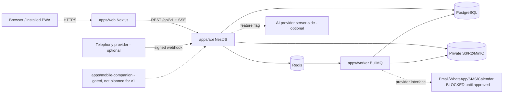
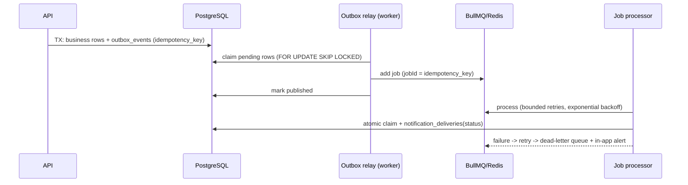

# Architecture (Phase 0)

Date: 2026-10-14. Status: proposed, validated against AGENT_CONVENTIONS (stack fixed by ADR-001). Describes the target; nothing here claims implementation.

## 1. Principles
1. Every active lead has a responsible owner and a next action, or sits in a visible exception queue.
2. Deterministic CRM first; AI and Android are optional, flag-gated add-ons.
3. Server-side authorization on every endpoint, deny-by-default, org-scoped, IDOR-safe.
4. One source of truth for numbers: a single role-scoped KPI query layer.
5. Reliability by construction: transactional outbox, idempotency keys, bounded retries, dead-letter, recoverable jobs.
6. Modular monolith; split only on measured need (ADR-002).

## 2. System context



## 3. Repository layout (Blueprint structure, ADR-002)

```
apps/web  apps/api  apps/worker  apps/mobile-companion(README only)
packages/shared-types  packages/validation  packages/ui
prisma/schema/{identity,crm,revenue,people,cx,platform}.prisma  prisma/migrations
docs/  docker-compose.yml  README.md  CLAUDE.md  CHANGELOG.md
```

## 4. API modules (NestJS, one folder per domain under `apps/api/src/modules/`)
`identity` (auth, users, teams, audit, policy), `crm` (leads, calls, tasks, assignment, import, duplicates, events), `revenue` (targets, deals, payments, refunds, forecasts, proposals), `analytics` (KPI engine, dashboards, reports/exports), `sop`, `people` (coaching, reviews, PIP, incentives, hiring), `cx` (complaints, handover, xf-tasks, founder reports), `platform` (notifications, files, webhooks, integrations, devices), `ai` (flag-gated).

Cross-cutting: central **policy layer** (permission key + scope resolver: own/team/org/summary, delegation), request-id middleware, response envelope interceptor, exception filter, Zod validation pipe, rate limiter, idempotency interceptor, audit interceptor/service, structured logger with redaction.

Rules: modules talk through service interfaces, never through another module's tables directly except via owned read models; Prisma access only inside module repositories; no controller without a declared permission (lint rule + test that enumerates routes).

## 4a. Authorization flow
Request -> session cookie auth -> CSRF check (mutations) -> load principal (user, primary role, secondary groups, team tree, delegations) -> route permission key -> scope resolver builds a Prisma `where` fragment (organization_id AND scope predicate) -> repository applies fragment -> 404 on miss (IDOR-safe) -> audit if sensitive. Client-supplied org/manager/assignee ids are validated against server-resolved scope.

## 5. Worker and reliability (ADR-003)


Sweeper jobs (overdue tasks, unattended leads, reminder re-evaluation) are idempotent and re-run after restart. Delivery status progresses QUEUED -> SENT -> DELIVERED/FAILED only from provider confirmation; in-app notifications are DELIVERED when persisted.

## 6. Data
PostgreSQL with Prisma multi-file schema; money Decimal; UTC; UUID; organization_id; append-only history/audit tables; unique constraints for idempotency (payments external ref, import keys). See docs/data-model.md.

## 7. Frontend
Next.js App Router, Tailwind, shadcn-style components in `packages/ui`, Framer Motion (reduced-motion safe), RHF + Zod (schemas shared from `packages/validation`). Feature-first: `apps/web/src/features/<domain>/`, routes under `(app)/<domain>/`. Permission-aware nav fetched from `/auth/me` (UI hiding is cosmetic). i18n via message catalogues (en, hi, mr). PWA per ADR-004. SSE hook with polling fallback.

## 8. Live updates
SSE `/api/v1/stream` authenticated by the session cookie, emits only events the principal may see; fallback polling on `GET /notifications?since=`.

## 9. KPI engine
`analytics` module exposes `KpiService.compute(kpiId, params, principal)` used by every dashboard/report/export. It injects the scope predicate, returns `{value|null, numerator, denominator, window, currency, definitionId, freshAt, source}`. Heavy reports run in the worker with signed download links. Cache keys include principal scope hash and invalidate on relevant domain events.

## 10. Files
Private bucket; authenticated upload via API; allowlist + magic-byte MIME check; generated keys; malware scan hook; async processing worker; short-lived signed URLs. See docs/file-storage-policy.md.

## 11. Observability
Request IDs propagated to worker jobs; structured JSON logs (pino) with redaction; `/health`, `/ready`; error-monitoring hook; metrics for queue depth, DLQ size, outbox lag (alerts in runbook).

## 12. Environments and deployment
dev (docker compose: Postgres 5533, Redis 6391, MinIO 9100 on this machine, `salesos-*` containers only), staging, prod. Shared-VPS safety rules in docs/deployment-runbook.md. Ports: web 3100, api 4100.

## 13. Telephony and Android
MVP: `tel:` dialer + mandatory manual disposition; calls labelled MANUAL. Device/provider-verified sources reserved in schema and UI. Companion app NO-GO for v1 (ADR-005).

## 14. Non-goals (v1)
Payments gateway, auto refunds, call recording/transcription, HRMS/payroll, microservices, replacing an existing CRM, SOC2/ISO claims.
