# Data Model (initial ERD and table catalogue, Phase 0)

Date: 2026-10-14. Conventions (all tables unless noted): UUID PK `id`; `organization_id` FK (tenant scope; single company today); `created_at`/`updated_at` TIMESTAMPTZ (UTC); money = `Decimal(14,2)` + `currency` CHAR(3) default INR; enums via Prisma enums; soft delete only where stated; audit/history tables append-only (no UPDATE/DELETE grant); optimistic `version` int on mutable aggregates with state machines. Multi-file Prisma schema, one file per domain: `prisma/schema/{identity,crm,revenue,people,cx,platform}.prisma` (ADR-002). Table names snake_case plural; Prisma models PascalCase with `@@map`.

Indexes required by the Blueprint: leads (organization_id, assigned_to, status, created_at); tasks (status, due_at, assigned_to); call_logs (lead_id, created_at DESC). Add: unique (organization_id, phone_e164) is NOT unique (duplicates are flagged not blocked) -> plain index; payments unique (organization_id, provider, external_transaction_ref); import_jobs unique (organization_id, idempotency_key); notification_deliveries unique (idempotency_key); outbox_events (status, available_at).

## ERD (core)

```mermaid
erDiagram
    ORGANIZATIONS ||--o{ USERS : has
    ORGANIZATIONS ||--o{ TEAMS : has
    USERS ||--o{ USER_ROLE_ASSIGNMENTS : holds
    ROLES ||--o{ USER_ROLE_ASSIGNMENTS : granted
    ROLES ||--o{ ROLE_PERMISSIONS : includes
    PERMISSIONS ||--o{ ROLE_PERMISSIONS : in
    TEAMS ||--o{ TEAM_MEMBERSHIPS : contains
    USERS ||--o{ TEAM_MEMBERSHIPS : member
    USERS ||--o{ SESSIONS : has
    USERS ||--o{ AUDIT_LOGS : actor
    USERS ||--o| USERS : manager

    LEAD_SOURCES ||--o{ LEADS : originates
    PROGRAMS ||--o{ LEADS : interest
    USERS ||--o{ LEADS : owns
    LEADS ||--o{ LEAD_ASSIGNMENTS : history
    LEADS ||--o{ LEAD_STATUS_HISTORY : history
    LEADS ||--o{ LEAD_NOTES : has
    LEADS ||--o{ CALL_LOGS : has
    CALL_LOGS ||--o{ CALL_NOTES : has
    LEADS ||--o{ TASKS : has
    LEADS ||--o{ DUPLICATE_CANDIDATES : flagged
    LEADS ||--o{ EVENT_ATTENDANCE : attends
    EVENTS ||--o{ EVENT_ATTENDANCE : has
    IMPORT_JOBS ||--o{ IMPORT_ERRORS : has
    OUTBOX_EVENTS ||--o{ NOTIFICATION_DELIVERIES : triggers
    TASKS ||--o{ NOTIFICATION_DELIVERIES : notifies

    LEADS ||--o{ DEALS : converts
    PROGRAMS ||--o{ PROGRAM_PRICES : priced
    PROGRAMS ||--o{ DEALS : sold
    DEALS ||--o| SALES_RECORDS : books
    SALES_RECORDS ||--o{ SALE_ADJUSTMENTS : corrected
    DEALS ||--o{ PAYMENTS : collects
    PAYMENTS ||--o{ REFUNDS : refunded
    TARGET_PERIODS ||--o{ TARGETS : contains
    TARGETS ||--o{ TARGET_ALLOCATIONS : breaks_down
    TARGETS ||--o{ TARGET_REVISIONS : revised
    FORECASTS ||--o{ FORECAST_SNAPSHOTS : snapshots
    DEALS ||--o| HANDOVER_RECORDS : handed_over

    SOP_DOCUMENTS ||--o{ SOP_VERSIONS : versions
    SOP_VERSIONS ||--o{ SOP_ACKNOWLEDGEMENTS : acknowledged
    USERS ||--o{ COACHING_SESSIONS : coached
    USERS ||--o{ PERFORMANCE_REVIEWS : reviewed
    USERS ||--o{ IMPROVEMENT_PLANS : subject
    INCENTIVE_POLICIES ||--o{ INCENTIVE_RECOMMENDATIONS : applied
    USERS ||--o{ INCENTIVE_RECOMMENDATIONS : earns

    LEADS ||--o{ COMPLAINTS : raises
    COMPLAINTS ||--o{ COMPLAINT_EVENTS : history
    FOUNDER_REPORTS ||--o{ FOUNDER_REPORT_SNAPSHOTS : frozen
    FOUNDER_REPORTS ||--o{ ACTION_ITEMS : yields
    CROSS_FUNCTIONAL_TASKS ||--o{ XF_TASK_COMMENTS : has

    FILE_ASSETS }o--|| USERS : uploaded_by
```

## Table catalogue by domain

Owner column = Prisma file / agent domain. `*` = append-only. Phase = first phase that creates it.

### identity (`prisma/schema/identity.prisma`, P2; organizations/users baseline in P1)

| Table | Key fields / purpose | Phase |
|---|---|---|
| organizations | id, name, settings JSONB (timezone, working days/hours, currency, thresholds, stages, team size limit), created_at | P1 |
| users | id, organization_id, name, email (unique per org), password_hash, primary_role, manager_id, is_active, deactivated_at, job_title, department, preferred_language, failed_login_count, locked_until | P1/P2 |
| roles | id, key (FOUNDER_CEO...STUDENT_SUCCESS), is_primary, description | P2 |
| permissions | id, key `module:action`, description (seeded from docs/permissions-matrix.md) | P2 |
| role_permissions | role_id, permission_id, scope (org/team/own/summary) | P2 |
| user_role_assignments | user_id, role_id, granted_by, granted_at, revoked_at | P2 |
| delegations | grantor_user_id, grantee_user_id, scope_team_id, starts_at, ends_at, reason | P2 |
| teams | id, organization_id, name, lead_user_id, soft_limit | P2 |
| team_memberships | team_id, user_id, membership_role, joined_at, left_at | P2 |
| sessions | id, user_id, token_hash, ip_hash, user_agent, expires_at, revoked_at | P2 |
| password_reset_tokens | user_id, token_hash, expires_at, used_at | P2 |
| invitations | email, role, token_hash, expires_at, accepted_at | P2 |
| audit_logs* | id, organization_id, actor_id, action, entity_type, entity_id, before/after (redacted), ip_hash, request_id, created_at | P2 |

### crm (`crm.prisma`, P3)

| Table | Key fields / purpose |
|---|---|
| lead_sources | id, name, type (CAMPAIGN/WEBINAR/REFERRAL/IMPORT...), campaign fields, is_active |
| programs | id, key, name (i18n JSON), description, is_active (AI Sprint, CBAX, MCA X, MCA Elite X, CoachEasily X, events) |
| leads | id, organization_id, full_name, phone_e164, phone_raw, email, source_id, program_id, assigned_to, team_id, status, stage_category, interest_level, next_action_at, next_action_type, estimated_value, lost_reason, preferred_language, consent_status/at/source, is_key_prospect, last_activity_at, import_job_id, version |
| lead_assignments* | lead_id, from_user_id, to_user_id, changed_by, reason, changed_at |
| lead_status_history* | lead_id, old_status, new_status, changed_by, reason, created_at |
| lead_notes | lead_id, author_id, body, visibility |
| duplicate_candidates | lead_id, other_lead_id, match_type, status (OPEN/MERGED/DISMISSED), reviewed_by |
| call_logs* | lead_id, user_id, source (MANUAL/DEVICE_VERIFIED/PROVIDER_VERIFIED), direction, outcome, provider_call_id, started_at, duration_seconds, notes, interest_level, objection_category |
| call_notes | call_id, author_id, summary, objections, next_steps |
| tasks | lead_id, assigned_to, created_by, type, due_at, status, priority, completed_at, completion_note, rule_id, version |
| automation_rules | scope (org/team), outcome, delay, working-hours flag, max attempts, escalation thresholds |
| assignment_rules / round_robin_state | team_id, mode, weights, cursor |
| reassignment_queue | lead_id/task_id, reason (OWNER_DEACTIVATED...), status, resolved_by |
| reactivation_queue | lead_id, eligible_from, attempts, status |
| events | id, type (WEBINAR/DEMO/EVENT), program_id, starts_at, host, capacity, status |
| event_attendance | event_id, lead_id, status (state machine 2), joined_at, duration |
| import_jobs | idempotency_key, file_id, status, total/ok/error counts, created_by |
| import_errors | import_job_id, row_number, field, reason, raw_row |
| outbox_events | aggregate, type, payload, status, attempts, available_at, idempotency_key |
| notification_deliveries | user_id, task_id, channel, status, attempts, provider_reference, provider_error_code, idempotency_key |
| recording_assets | call_id, storage_key, consent_status, retention_until (RESERVED - unused until legal review) |

### revenue (`revenue.prisma`, P4)

| Table | Key fields / purpose |
|---|---|
| program_prices | program_id, amount, currency, effective_from, tax_inclusive, created_by (versioned) |
| target_periods | type (MONTH/QUARTER/YEAR), starts_on, ends_on |
| targets | period_id, metric (REVENUE/COLLECTION/ENROLMENT), owner_user_id, level, amount/count, currency, version |
| target_allocations | target_id, parent_target_id, assignee_user_id, amount, proration_basis |
| target_revisions* | target_id, old/new value, reason, approved_by |
| deals | lead_id, owner_id, program_id, stage, amount, currency, deal_type (NEW/UPSELL/CROSS_SELL), is_high_value, won_at, lost_at, lost_reason, version |
| deal_status_history* | deal_id, old, new, changed_by, reason |
| deal_blockers | deal_id, note, escalated_to, resolved_at |
| sales_records | deal_id, sale_value (immutable), currency, credited owner split JSON, closed_at |
| sale_adjustments* | sales_record_id, delta, reason, approved_by |
| payments | deal_id, amount, currency, method, external_transaction_ref (UNIQUE), provider, paid_at, status, recorded_by, verified_by, verified_at, proof_file_id |
| refunds | payment_id/deal_id, amount, reason_category, status, requested_by/at, reviewed_by/at, approved_by/at, processed_by/at, reconciled_at, external_ref |
| forecasts | period, method, params, created_by |
| forecast_snapshots* | forecast_id, taken_at, total, breakdown JSON (immutable) |
| pricing_proposals | type, details, status, submitted_by, decided_by, history |
| market_feedback / competitor_notes / learner_feedback / growth_opportunities | category, source, notes, owner, status |
| strategy_plans / strategy_initiatives | plan, owner, status |

### people / sop (`people.prisma`, P6)

| Table | Key fields / purpose |
|---|---|
| sop_documents | category, title, owner_id, is_mandatory |
| sop_versions | document_id, version, body, effective_date, status, approved_by, change_summary |
| sop_acknowledgements | version_id, user_id, acknowledged_at |
| process_gaps | title, owner, status, resolution, linked_sop_id |
| kpi_assignments | assignee_id, period (week), kpis/kras JSON, set_by |
| one_on_ones, coaching_sessions, coaching_actions | date, coach_id, participants, duration_min, topic (CALL_QUALITY...), notes, actions |
| scorecards, scorecard_reviews, performance_reviews, review_rubrics | period, scores, rating, status, acknowledgement |
| improvement_plans, pip_checkpoints | state machine 9 |
| recognition_programs, recognitions | program, recipient, reason |
| incentive_policies | version, formula structure JSON (no seeded amounts), status, approved_by, effective_from |
| incentive_recommendations | policy_version_id, employee_id, period, inputs snapshot JSON, amount, status (machine 10) |
| requisitions, candidates, interview_feedback, hiring_role_profiles | HR pipeline + criteria (experience/qualification) |
| onboarding_plans, onboarding_items, probation_reviews | checklists |
| succession_candidates | role, readiness (READY_NOW/READY_LATER), actions |
| employee_profiles | HR-restricted: employment_type, join_date, exit_date/type |
| engagement_surveys, engagement_responses | pulse (anonymous aggregation) |
| resources | library entries with skill tags |

### cx (`cx.prisma`, P7)

| Table | Key fields / purpose |
|---|---|
| complaints, complaint_events* | owner, priority, category, sla_due_at, status, resolution, root_cause |
| satisfaction_responses, enrolment_feedback | rating 1-5, comments, lead/deal link |
| relationship_notes | lead/learner history entries |
| escalations | high-value/complex conversation escalations |
| handover_records, handover_items | machine 6 |
| cross_functional_tasks, xf_task_comments, xf_task_dependencies | owner, department, status, due, minimum-data payload |
| campaign_plan_links | campaign/event <-> sales plan |
| insights | shared learner/market insights |
| founder_reports, founder_report_snapshots*, founder_report_risks | report builder; snapshots immutable |
| action_items | owner, due, status, evidence |

### platform (`platform.prisma`, P8/P9)

| Table | Key fields / purpose |
|---|---|
| notifications | user_id, type, payload, dedupe_key, read_at |
| notification_preferences | user_id, channel, quiet hours |
| file_assets | uploader_id, storage_key, original_name_hash, mime, size, checksum, processing_status, scan_status, retention_until, owner_entity |
| webhook_events | provider, event_id (unique), signature_valid, received_at, processed_at, replay_flag |
| integration_configs | provider, encrypted settings, enabled |
| idempotency_keys | key, endpoint, response_hash, expires_at |
| devices | user_id, platform, app_version, registered_at, revoked_at (P9, gated) |
| ai_usage_logs | user_id, feature, provider, tokens, latency_ms, cost, status |
| kpi_reconciliation_runs | kpi_id, expected, actual, ok, run_at |
| feature_flags | key, enabled |

## Reconciliation notes
Each domain agent owns its file; cross-domain FKs add back-relations to the owner's model via small atomic edits (see AGENT_CONVENTIONS). The lead reconciles consolidated migrations at wave end.

## Analytics tables (Phase 5, `prisma/schema/analytics.prisma`)

| Table | Purpose | Key columns |
|---|---|---|
| `report_exports` | one requested export; private file bytes + metadata | `requested_by_id`, `report`, `format` (CSV/XLSX), `status` (QUEUED/RUNNING/READY/FAILED/EXPIRED), `applied_filters`, `scope_level`, `row_cap`, `row_count`, `truncated`, `content` (bytea), `content_sha256`, `locked_until`/`attempts` (runner lease), `expires_at`, `download_count` |
| `kpi_snapshots` | daily organisation-level KPI values for history/trends | unique `(organization_id, kpi_id, scope_key='ORG', period_start, period_end)`, `value`/`numerator`/`denominator` Decimal(20,4) |
| `kpi_reconciliation_runs` | KPI-PRO-002 evidence | `trigger` (SCHEDULED/MANUAL), `total_checks`, `passed`, `failed`, `skipped`, `checks` JSON, `ran_at` |
| `saved_filters` | per-user saved filter sets | unique `(organization_id, user_id, target, name)`, `filters` JSON, `is_default` |

All tables use plain UUID columns for organisation/user references (no `@relation` into identity models). KPI values are never stored as truth: they are always computed from the source tables; snapshots are a convenience for history.
Extra indexes owned by analytics (created idempotently by `analytics-indexes.ts`): see docs/analytics-report.md section 10.
