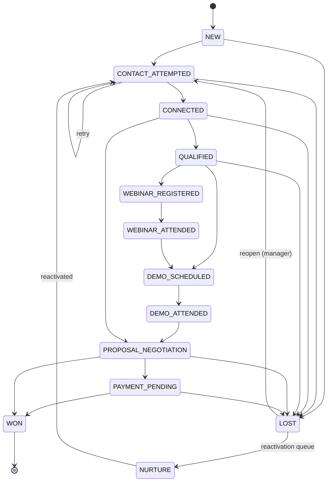
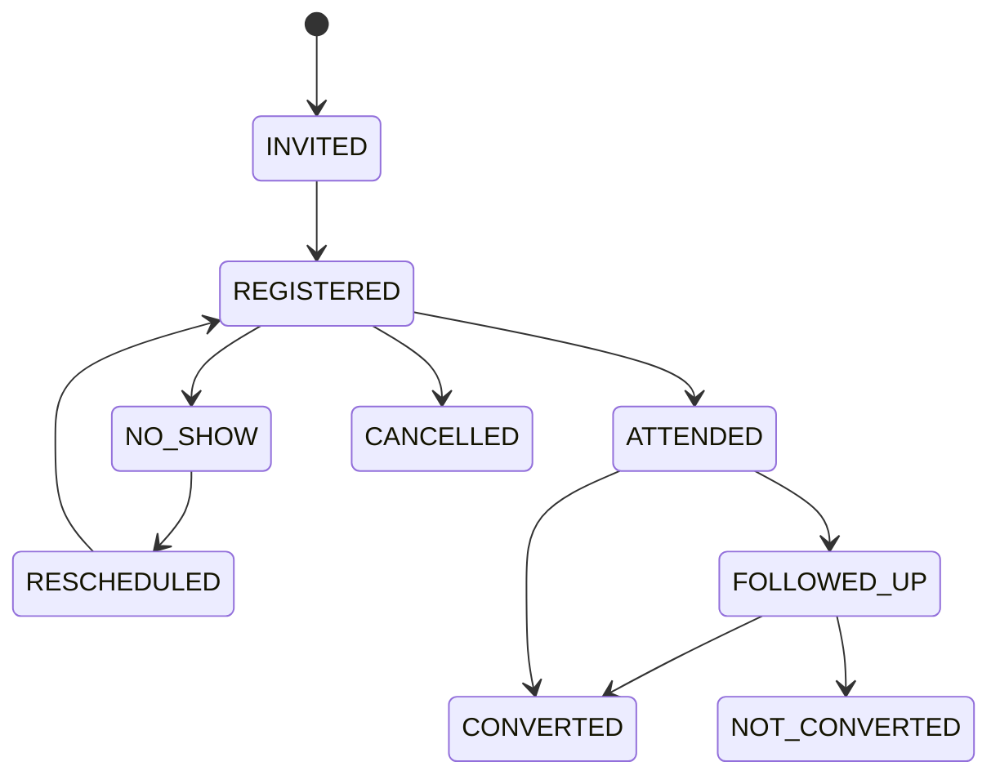
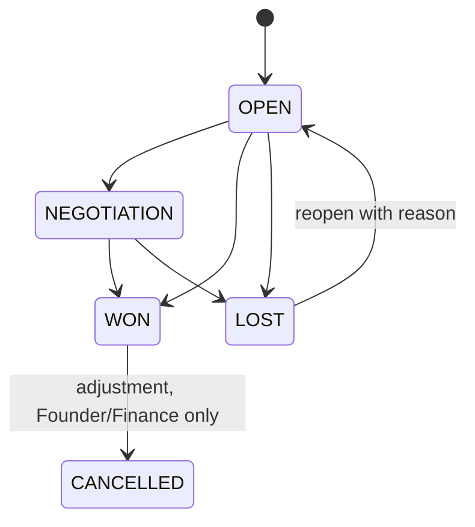
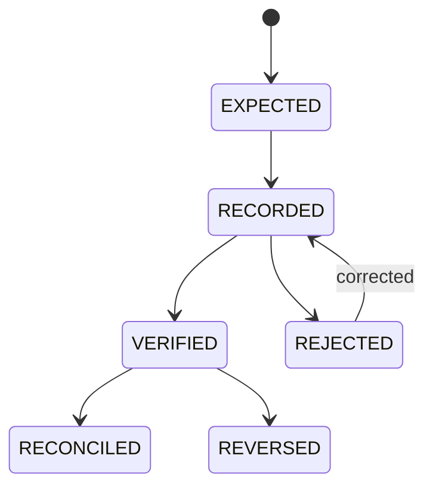
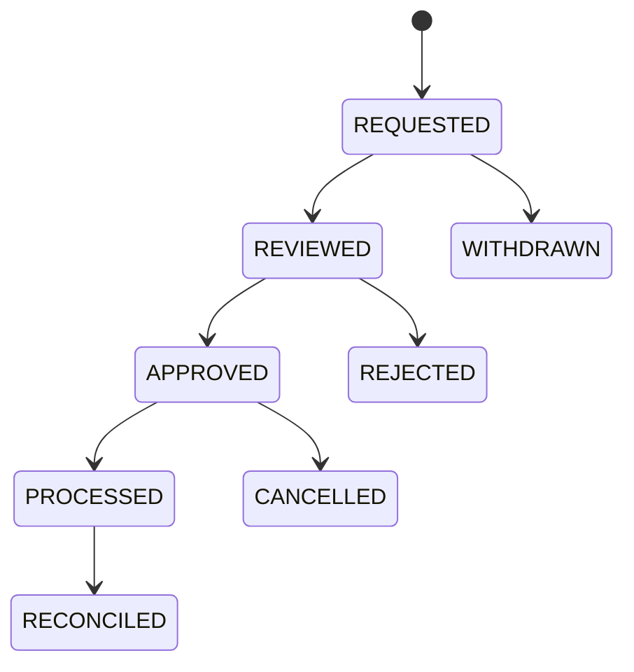
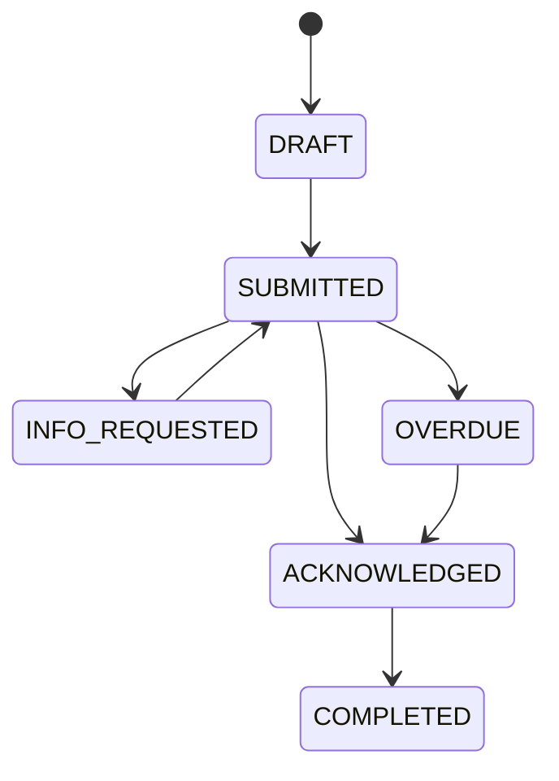
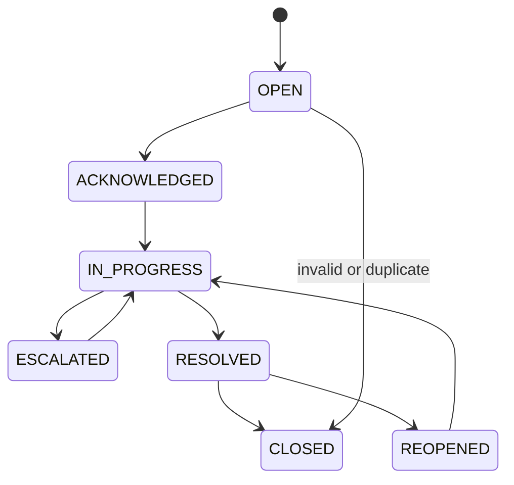
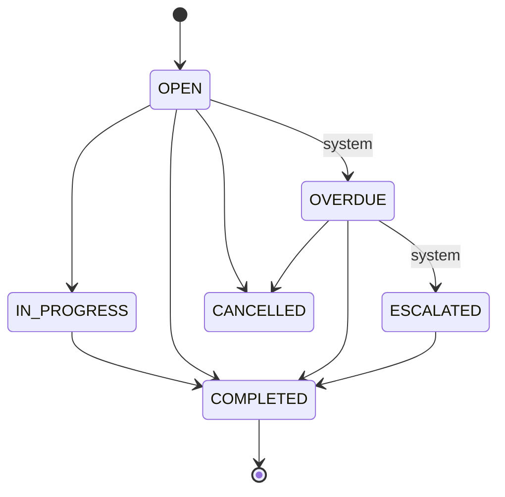
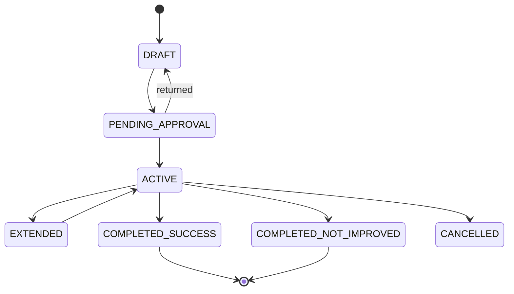
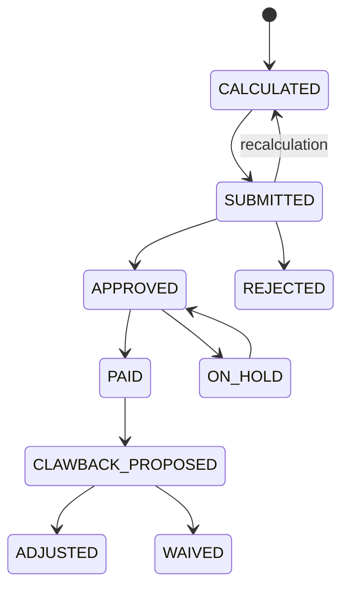

# State Machines (draft, Phase 0)

Date: 2026-10-14. Every transition below is enforced server-side by a single transition function per aggregate (no direct status updates), runs in ONE database transaction together with its history row, audit row, and outbox event(s), and rejects any transition not in the table (`409 INVALID_TRANSITION`). Idempotent re-submission of the same transition with the same `Idempotency-Key` returns the original result. Roles use primary names; secondary groups in brackets. Default values reference docs/decision-log.md.

Common failure handling: validation failure -> 422 with field errors, no state change; concurrent modification -> optimistic `version` check -> 409, client reloads; unauthorised -> 404/403 per IDOR policy; side-effect (notification) failure never rolls back the business transition: outbox retries with backoff then dead-letters and raises an in-app alert.

---

## 1. Lead lifecycle

Stages are configurable (DEC-006); the machine is defined on stage *categories* (OPEN, WON, LOST, NURTURE) with an ordered default list; forward skips are allowed for stages marked skippable, backward moves require a reason. Orthogonal flags: `owner` (never null for an OPEN lead; null -> exception queue), `next_action_at`, `duplicate_flag`.

| From | To | Required fields | Roles (scope) | Side effects | Audit | Failure handling |
|---|---|---|---|---|---|---|
| (create) | NEW | full_name, phone (E.164 or flagged raw), source, consent status | Exec own, Mgr team, TL, Founder, import worker | duplicate check -> duplicate_candidates; round-robin/manual assign; first-contact task (SLA per DEC-026) | lead.created | invalid phone: accept as flagged_raw with warning; duplicate: create + flag, never merge |
| NEW | CONTACT_ATTEMPTED | call_log outcome in NO_ANSWER/BUSY/SWITCHED_OFF/FAILED | owner, Mgr, TL | retry task per automation rule (same tx) | lead.status_changed + call.created | task creation fail rolls back call log |
| CONTACT_ATTEMPTED | CONNECTED | call_log CONNECTED, interest_level, next action | owner | next-action task; last_activity_at | lead.status_changed | missing next action -> 422 |
| CONNECTED | QUALIFIED | interest_level, program_id (if known), objection category optional | owner, Mgr | qualification timestamp | lead.status_changed | - |
| QUALIFIED/CONNECTED | WEBINAR_REGISTERED | event_id | owner, Mgr, Marketing(summary) | attendance row REGISTERED; reminder tasks | lead.status_changed | event full/cancelled -> 409 |
| WEBINAR_REGISTERED | WEBINAR_ATTENDED | attendance=ATTENDED (manual or import) | owner, Mgr, Marketing | conversion-attribution anchor set (DEC-010) | lead.status_changed | - |
| QUALIFIED/WEBINAR_ATTENDED | DEMO_SCHEDULED | demo datetime, host | owner, Mgr | demo task + reminder | lead.status_changed | scheduling in past -> 422 |
| DEMO_SCHEDULED | DEMO_ATTENDED | attendance=ATTENDED | owner, Mgr | attribution anchor | lead.status_changed | no-show -> stays DEMO_SCHEDULED with reschedule/no-show reason |
| CONNECTED/DEMO_ATTENDED | PROPOSAL_NEGOTIATION | estimated_value, program | owner, Mgr | opportunity (deal OPEN) created in same tx | lead.status_changed, deal.created | deal creation failure rolls back |
| PROPOSAL_NEGOTIATION | PAYMENT_PENDING | deal amount, currency, payment due | owner | collection expected record; high-value check -> escalation | deal.status_changed | amount > threshold -> escalate flag |
| PROPOSAL_NEGOTIATION/PAYMENT_PENDING | WON | deal closed-won fields (see section 3) | owner, Mgr, TL | deal close tx; resolve open follow-ups; onboarding + handover tasks; target achievement update | lead.won + deal.closed | all-or-nothing transaction |
| any OPEN | LOST | lost_reason (mandatory), note if OTHER | owner, Mgr, TL | cancel open tasks; reactivation rule scheduling (DEC-031) | lead.lost | NEVER automatic from NO_ANSWER; only explicit human action |
| LOST | NURTURE | reactivation rule matched (system) or manual | system, Mgr | enters reactivation queue | lead.status_changed | consent withdrawn/DND -> blocked |
| NURTURE/LOST | CONTACT_ATTEMPTED | reopen reason; owner | Mgr, TL (executive only via queue assignment) | new owner assignment + task | lead.reopened | WON is terminal: cannot reopen (create new deal instead) |
| any OPEN | (owner removed) | owner deactivated | system | reassignment_queue entry; lead flagged exception; manager notified | lead.exception_raised | queue entry unique per lead |

---

## 2. Webinar/demo participation

| From | To | Required fields | Roles | Side effects | Audit | Failure handling |
|---|---|---|---|---|---|---|
| (none) | INVITED | lead_id, event_id | Exec, Mgr, Marketing/Ops [events:manage] | - | attendance.created | duplicate (lead,event) -> idempotent no-op |
| INVITED | REGISTERED | registration time | Exec, Mgr, Marketing, import | reminder tasks | attendance.updated | event closed -> 409 |
| REGISTERED | ATTENDED | joined_at or manual mark, optional duration | Exec, Mgr, Ops, Marketing, import worker | sets attribution anchor; creates follow-up task within 24h | attendance.updated | conflicting import vs manual: manual wins, conflict logged |
| REGISTERED | NO_SHOW | event ended | Exec, Mgr, system | no-show follow-up task | attendance.updated | - |
| REGISTERED | CANCELLED | reason | Exec, Mgr | - | attendance.updated | - |
| NO_SHOW | RESCHEDULED -> REGISTERED | new event_id | Exec, Mgr | new attendance row linked | attendance.created | - |
| ATTENDED | FOLLOWED_UP | follow-up call logged | owner | - | attendance.updated | - |
| ATTENDED/FOLLOWED_UP | CONVERTED | WON deal within window (DEC-010) | system (derived) | contributes to KPI-SAL-002/003 | derived (no manual edit) | window expired -> stays NOT_CONVERTED |
| FOLLOWED_UP | NOT_CONVERTED | window elapsed or lost | system | - | derived | - |

---

## 3. Opportunity / sale (deal)

Money fields: sale_value (immutable after WON; corrections = `sale_adjustments`), amount_due, amount_collected, amount_refunded, net_collected (derived). Closed-Won never implies paid.

| From | To | Required fields | Roles | Side effects | Audit | Failure handling |
|---|---|---|---|---|---|---|
| (create) | OPEN | lead_id, program_id, amount (Decimal), currency, owner | Exec own, Mgr, TL | high-value check (DEC-027) | deal.created | amount<=0 -> 422 |
| OPEN | NEGOTIATION | blocker notes optional | owner, Mgr | - | deal.status_changed | - |
| OPEN/NEGOTIATION | WON | closed_at, final amount, program, credited owner(s) (DEC-005), payment plan/due | owner, Mgr, TL | ONE tx: deal + lead status history + follow-up/onboarding/handover tasks + target progress; collections expected record | deal.closed (won) | tx rollback on any failure; double-close idempotent |
| OPEN/NEGOTIATION | LOST | lost_reason | owner, Mgr, TL | lead LOST per lead machine; reactivation schedule | deal.closed (lost) | - |
| any OPEN | (escalate) | blocker note, requested help | owner, Mgr | notification to TL/Founder; escalation record | deal.escalated | - |
| WON | CANCELLED | reason, approver | Founder, FINANCE | adjustment record; reverses attributed revenue; refund link optional | deal.cancelled | refunds exist -> must be PROCESSED first |
| LOST | OPEN | reopen reason | Mgr, TL | new tasks | deal.reopened | WON cannot be reopened |

---

## 4. Payment / collection

| From | To | Required fields | Roles | Side effects | Audit | Failure handling |
|---|---|---|---|---|---|---|
| (create) | EXPECTED | deal_id, amount, due_date | system on WON | expected collections list | payment.expected | - |
| EXPECTED/(create) | RECORDED | amount, currency, method, external_transaction_ref (UNIQUE per org+provider) , paid_at, proof file optional | Exec (own), Mgr, TL, FINANCE [collections:create] | updates amount_collected pending view | payment.recorded | duplicate ref -> 409 DUPLICATE_PAYMENT, no credit |
| RECORDED | VERIFIED | verifier != recorder (separation of duties) | FINANCE [collections:verify] only | counts toward collection KPI; deal amount_collected updated; notifies owner | payment.verified | amount mismatch beyond tolerance -> reject with reason |
| RECORDED | REJECTED | reason | FINANCE | notify recorder | payment.rejected | - |
| VERIFIED | RECONCILED | bank/gateway statement ref | FINANCE, Founder | locks payment | payment.reconciled | unmatched stays VERIFIED in reconciliation view |
| VERIFIED | REVERSED | reason, approver | FINANCE + Founder | adjustment; collection KPI reduced | payment.reversed | linked refund must exist or reason given |

---

## 5. Refund

Authority default (DEC-019): Team Lead/Manager review and recommend; Founder or FINANCE approves/rejects; FINANCE processes and reconciles. Requested != approved != processed: separate timestamps, actors and roles. No automatic payout/refund.

| From | To | Required fields | Roles | Side effects | Audit | Failure handling |
|---|---|---|---|---|---|---|
| (create) | REQUESTED | deal_id/payment_id, amount <= collected - refunded, reason category, requester | Exec, Mgr, TL, Student Success | notify reviewer; incentive-clawback hook flagged (DEC-015) | refund.requested | amount over cap -> 422 |
| REQUESTED | REVIEWED | review note, recommendation | Mgr, TL, FINANCE [refunds:review] | notify approver | refund.reviewed | - |
| REQUESTED | WITHDRAWN | reason | requester, TL | - | refund.withdrawn | - |
| REVIEWED | APPROVED | approved amount, reason | Founder, FINANCE [refunds:approve] (not the requester) | notify FINANCE to process; refund-reduction KPI | refund.approved | requester==approver -> 403 |
| REVIEWED | REJECTED | reason | Founder, FINANCE | notify requester | refund.rejected | terminal |
| APPROVED | PROCESSED | external_ref, processed_at, amount, method | FINANCE only | net collections reduced; clawback proposal created (not applied) | refund.processed | duplicate external_ref -> 409 |
| PROCESSED | RECONCILED | statement ref | FINANCE | lock | refund.reconciled | - |
| APPROVED | CANCELLED | reason | Founder, FINANCE | - | refund.cancelled | not allowed after PROCESSED |

---

## 6. Student Success handover

| From | To | Required fields | Roles | Side effects | Audit | Failure handling |
|---|---|---|---|---|---|---|
| (create) | DRAFT | deal WON, learner contact, program | system on WON / owner | checklist generated | handover.created | - |
| DRAFT | SUBMITTED | checklist complete: learner name, contact, language, program, amount paid/due, payment verified flag, promises made, goals, objections, special notes | owner, Mgr | notify Student Success queue; pending-handover alert timer (default 24h) | handover.submitted | missing items -> 422 listing fields |
| SUBMITTED | ACKNOWLEDGED | receiving owner | STUDENT_SUCCESS | stops alert; sale owner notified | handover.acknowledged | - |
| SUBMITTED | INFO_REQUESTED | questions | STUDENT_SUCCESS | task to sales owner | handover.info_requested | - |
| SUBMITTED | OVERDUE | no ack within timer | system | escalate to Mgr then TL | handover.overdue | - |
| ACKNOWLEDGED | COMPLETED | onboarding confirmed | STUDENT_SUCCESS | enrolment-experience survey scheduled | handover.completed | - |

---

## 7. Complaint / escalation

| From | To | Required fields | Roles | Side effects | Audit | Failure handling |
|---|---|---|---|---|---|---|
| (create) | OPEN | learner/lead, category, priority (DEC-017), description, owner | Exec, Mgr, TL, Student Success | SLA timers start (business hours); notify owner | complaint.created | missing owner -> auto-assign to Mgr, flagged |
| OPEN | ACKNOWLEDGED | first response note | owner | first-response SLA stops | complaint.acknowledged | breach -> notify owner->TL->Founder (P1) |
| ACKNOWLEDGED | IN_PROGRESS | plan/next action | owner | - | complaint.updated | - |
| IN_PROGRESS | ESCALATED | reason, escalated-to | owner, Mgr | notify TL/Founder; high-value flag | complaint.escalated | - |
| ESCALATED | IN_PROGRESS | decision note | TL, Founder | - | complaint.updated | - |
| IN_PROGRESS | RESOLVED | resolution, root-cause category | owner, Mgr | satisfaction survey scheduled; refund link optional | complaint.resolved | root cause mandatory |
| RESOLVED | CLOSED | learner confirmation or 7 days elapsed | system, owner | KPI-CX-003 | complaint.closed | - |
| RESOLVED | REOPENED | reason | owner, Mgr, TL | SLA restarts (new clock) | complaint.reopened | - |
| OPEN | CLOSED | reason invalid/duplicate | Mgr, TL | - | complaint.closed | - |

---

## 8. Task / action item

Applies to lead tasks (follow-up/callback/demo/email), cross-functional tasks and Founder action items (the latter two add `evidence` and `dependencies`).

| From | To | Required fields | Roles | Side effects | Audit | Failure handling |
|---|---|---|---|---|---|---|
| (create) | OPEN | owner, due_at, type, priority, lead/context | Exec, Mgr, TL, system rules | outbox reminder events scheduled | task.created | owner inactive -> reassignment queue |
| OPEN | IN_PROGRESS | - | owner | - | task.updated | - |
| OPEN/IN_PROGRESS | COMPLETED | completion_note (required for callbacks and action items; evidence for action items) | owner, Mgr, TL | next task optional; lead last_activity_at; cancels pending reminders | task.completed | double completion idempotent |
| OPEN | OVERDUE | now > due_at (worker, atomic claim) | system | notify owner; schedule escalation | task.overdue | worker restart: sweep job re-evaluates, idempotent key prevents duplicate notification |
| OVERDUE | ESCALATED | threshold reached (DEC-026) | system | notify Manager then TL | task.escalated | - |
| OPEN/OVERDUE | CANCELLED | reason | owner, Mgr, TL | cancels reminders | task.cancelled | completed tasks cannot be cancelled |
| COMPLETED | (reopen) | not allowed | - | create a new task | - | - |

---

## 9. Performance Improvement Plan (PIP)

| From | To | Required fields | Roles | Side effects | Audit | Failure handling |
|---|---|---|---|---|---|---|
| (create) | DRAFT | employee, reason, KPI gaps, evidence | TL (manager PIPs); Mgr proposes for executives | restricted visibility (HR data) | pip.created | - |
| DRAFT | PENDING_APPROVAL | goals, measures, duration (default 30 days), checkpoints | TL | notify Founder/HR | pip.submitted | - |
| PENDING_APPROVAL | ACTIVE | approver, start date, employee acknowledgement | Founder or HR [pip:approve] | checkpoint tasks + coaching sessions scheduled | pip.activated | no ack -> remains pending, reminder |
| ACTIVE | EXTENDED | reason, new end date (max 1 extension) | TL + approver | checkpoint tasks regenerate | pip.extended | second extension -> 422 |
| ACTIVE | COMPLETED_SUCCESS | final review, evidence | TL, HR | recognition suggestion; KPI baseline reset | pip.completed | - |
| ACTIVE | COMPLETED_NOT_IMPROVED | final review, evidence, recommended action | TL, HR, Founder | notifies HR; outcome handled outside SalesOS (no payroll/termination workflow, DEC-023) | pip.completed | - |
| ACTIVE/DRAFT | CANCELLED | reason | Founder, HR | - | pip.cancelled | - |

---

## 10. Incentive recommendation

Calculation uses the Founder-approved versioned incentive_policy only (DEC-015). If no approved policy: state machine cannot start (`POLICY_NOT_CONFIGURED`). A recommendation is never a payment. AI never advances this machine.

| From | To | Required fields | Roles | Side effects | Audit | Failure handling |
|---|---|---|---|---|---|---|
| (create) | CALCULATED | policy_version_id, employee, period, inputs snapshot (sales, collections, refunds), computed amount | system on TL request | immutable inputs snapshot stored | incentive.calculated | policy missing -> 409 |
| CALCULATED | SUBMITTED | TL comments | TL (Mgr proposes) | notify Founder | incentive.submitted | - |
| SUBMITTED | APPROVED | approver, approved amount (<= computed unless override reason) | Founder only | notify FINANCE and employee (status only) | incentive.approved | approver==recommender -> 403 |
| SUBMITTED | REJECTED | reason | Founder | notify TL | incentive.rejected | terminal |
| SUBMITTED | CALCULATED | recalculation reason | TL | new snapshot version | incentive.recalculated | - |
| APPROVED | PAID | paid_at, reference | FINANCE | status visible to employee | incentive.paid | payout executed outside SalesOS |
| APPROVED | ON_HOLD | reason (e.g. pending refund window) | Founder, FINANCE | - | incentive.held | - |
| PAID | CLAWBACK_PROPOSED | linked processed refund within window (DEC-015) | system proposes | notify Founder/FINANCE | incentive.clawback_proposed | never auto-applied |
| CLAWBACK_PROPOSED | ADJUSTED / WAIVED | decision, amount | Founder, FINANCE | adjustment record on next period | incentive.adjusted / waived | - |
